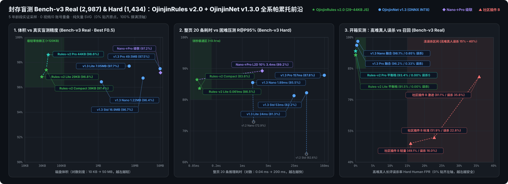
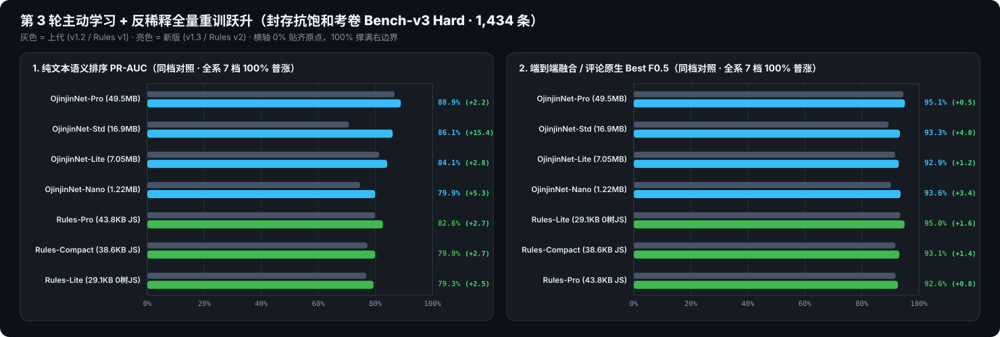
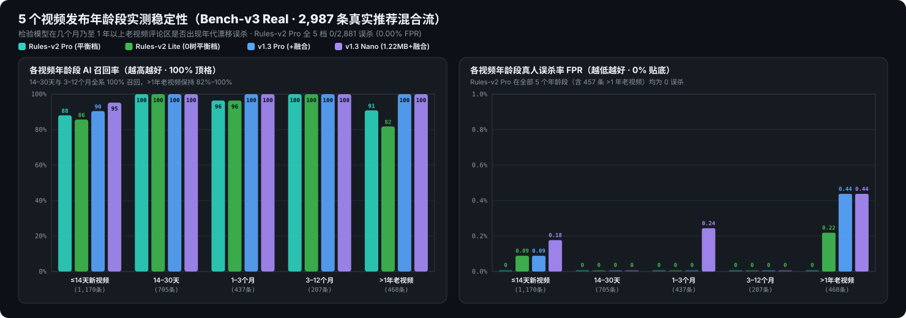

# OjinjinNet

[](LICENSE)
[](../../releases)
[](https://onnxruntime.ai/)
[](pyproject.toml)

`OjinjinNet` 是一个面向中文社区评论区的轻量级端侧 AI 评论检测模型家族。所有模型均导出为纯 CPU ONNX INT8 格式（体积覆盖 `1.22 MB – 49.49 MB`），不依赖 PyTorch 或移动端 GPU，重点解决去掉常见关键词与模板口癖后的隐蔽 AI 评论识别问题，并支持 `Nano → Pro` 两级级联分诊。

> **寻找 30 KB 级零依赖纯 JS 方案（适用于油猴脚本 / 浏览器扩展）？**
> 配套零依赖蒸馏产物 [**OjinjinRules v2.0**](https://github.com/LiJiaHua1024/OjinjinRules)（`29.1 – 43.8 KB` 纯 ES5 JS / `9.9 – 15.6 KB` gzip，无 WASM / 无 ONNX / 无联网，`0.048 – 0.072 ms / 20 条`）在封存真实考卷 `Bench-v3 Real` 平衡档实测达 **`100.0%` 精确率 / `93.4%` 召回率（`0 / 2,881` 误杀）**。

### 主要特性

- **四档轻量纯 CPU ONNX INT8 推理**：提供 `1.22 MB`（Nano，零自注意力多字哈希卷积 Static QDQ INT8）、`7.05 MB`（Lite KD）、`16.86 MB`（Standard KD）、`49.49 MB`（Pro SmoothQuant INT8）四档模型；开启 `--parallel-buckets` 后，`Nano v1.3` 在 PC 4 线程端到端单条 **`0.29 ms`**、整页 20 条分桶仅需 **`1.89 ms`**（短评批量 `bs=32` 端到端 **`18,255 条/秒`**）。
- **开箱即用的 `Nano v1.3 → Pro v1.3` 两级级联（`OjinjinCascadeClassifier`）**：`Nano` 先在 `1.89 ms` 内分诊绝大多数明确评论，在真实分布封存卷 `Bench-v3 Real` 上仅将 **`3.1% – 5.5%`** 边界评论转交 `Pro` 复核——`L2D-FP 10%` 档端到端 20 条整页 `p50` 仅 **`3.4 ms`**（均值 `8.8 ms`，较全量运行 `Pro` 的 `157.4 ms` 提速 **`46.3×` / 均值 `17.9×`**），且在困难压测卷 `Bench-v3 Hard` 取得 **`R@P95% 89.2%`**，反超全量 `Pro`（`87.8%`）。
- **第 3 轮主动学习 + 反稀释全量重训（`v1.3.0`）**：基于 `67,612` 条实证推荐流抓取（覆盖首页推荐 / 相关视频 / 中性搜索与 `≤14 天` 至 `>1 年` 全 5 个视频年龄段），剔除 369 条模糊灰区并严守 65% 自然流量配比从头重训，在抗饱和考卷 `Bench-v3 Hard` 上全系普涨（`Standard` 纯文本 `PR-AUC +15.4 pp`、`+融合 R@P95% +19.6 pp`；`Nano +融合 R@P95% +12.6 pp`），且跨 `>1 年` 老视频无年代漂移误杀。
- **极简运行时与长度分桶**：Python 推理包仅依赖 `onnxruntime` 与 `numpy`，内置单遍 WordPiece 分词、8K 词片缓存、自动长度分桶批处理（`bucketed=True`）及 1 KB 元信息融合权重，便于移植至 Kotlin、Swift、Rust 或 JavaScript。

---

## 封存盲测实绩一览（`OjinjinBench-v3 Real & Hard`）







> 交互式评测看板：[`docs/index.html`](docs/index.html)（支持切换 `Bench-v3 Real/Hard`、`Bench-v2`、`Bench-v1` 及 23 款公开方案横向对比），完整评测协议见 [`docs/BENCHMARK.md`](docs/BENCHMARK.md)。

---

## 模型规格与实测性能（`v1.3.0` + 配套 `Rules v2.0`）

ONNX 模型权重通过 [GitHub Releases](../../releases) 分发，每档压缩包包含 `model_int8.onnx`（Nano 另含 `model_cascade_int8.onnx`）、`vocab.txt`、`fusion_weights.json`、`manifest.json` 与 `NOTICE`，并附带 `SHA256SUMS.txt` 校验文件。

| 规格 | 底座 / 量化方式 | 体积 | PC 4 线程 (`--parallel-buckets`)<br>单条 / 整页 20 条 (p50) | 吞吐 (`bs=32` / 整页) | 适用场景 |
|---|---|---:|---:|---:|---|
| *配套 Tier 0：[`OjinjinRules v2.0`](https://github.com/LiJiaHua1024/OjinjinRules)* | *纯 ES5 JS 静态蒸馏规则（0 依赖）* | ***29.1 – 43.8 KB*** | ***2.4–3.6 µs / 0.048–0.072 ms*** | ***27万–41万 条/秒 (V8)*** | *油猴脚本、浏览器扩展、零 WASM 同步拦截* |
| **`OjinjinNet-Nano v1.3`** | 多字哈希卷积 (Bigram+Trigram+DWConv) · Static QDQ INT8 | **1.22 MB** | **0.29 ms / 1.89 ms** | **18,255 / 10,579 条/秒** | 极低体积、弹幕流、两级级联第一级 |
| **`OjinjinNet-Lite v1.3`** | MiniRBT-h256 (4L-256H, Super-Teacher KD) · Dynamic INT8 | 7.05 MB | 1.74 ms / 24.3 ms | 1,510 / 823 条/秒 | 单文件轻量部署，`Bench-v3 Real` 综合 PR 最高 (`0.9961`) |
| **`OjinjinNet-Standard v1.3`** | BGE-small-zh-v1.5 (4L-512H, Super-Teacher KD) · Dynamic INT8 | 16.86 MB | 3.32 ms / 52.8 ms | 717 / 379 条/秒 | 单文件纯文本均衡部署，`Bench-v3 Real` 纯文 PR 最高 (`0.9412`) |
| **`OjinjinNet-Pro v1.3`** | MacBERT-6L 剪枝 (6L-768H) · SmoothQuant INT8 | 49.49 MB | 8.30 ms / 157.4 ms | 235 / 127 条/秒 | 单模型语义与抗饱和困难考卷上限 (`Hard PR 0.8891 / 0.9719`) |
| **`Nano → Pro v1.3` 级联** | `Nano` (L2D-FP 10% / Naive 15%) + `3.1%–5.5%` 转交 `Pro` | 1.22 + 49.49 MB | — / **3.4 – 10.7 ms** (均值 `8.8–12.5`) | **14.7× – 46.3× 提速** | **综合推荐**：`L2D 10%` 达 `3.4 ms` 且 `Hard R@P95 89.2%` 反超全量 Pro |

> **实测说明**：统一最大序列长度 `max_len=192`（Head 140 + Tail 50），整页 20 条分桶采用 `ojinjinnet-speedbench` 确定性混合长度分布（`12×32 + 5×64 + 3×128`），在本地 PC（AMD Ryzen 5 5600X · 4 线程 ONNX Runtime，`--parallel-buckets`）实测，串行与并行输出完全一致（`max_logit_diff = 0`）。移动端骁龙 865（Android 16 ARM64 · 4 线程）同架构整页分桶参考：Lite `56.4 ms`、Standard `106.4 ms`、Pro `314.2 ms`。

---

## 快速开始

1. 从 [GitHub Releases](../../releases) 下载任意规格的 `v1.3.0` 模型包（如 `ojinjinnet-nano-int8-v1.3.0.zip` 与 `ojinjinnet-pro-int8-v1.3.0.zip`），解压至 `./models/nano/`、`./models/pro/`。
2. 使用 `uv` 安装推理依赖（仅 `onnxruntime` 与 `numpy`）：

```bash
uv sync
```

3. 命令行直接推理或开启两级级联：

```bash
# 单模型推理
uv run ojinjinnet --model-dir ./models/standard \
  "这波属实难绷，看完了直接笑出声" \
  "不得不说这个视角确实很独特，不是简单的情绪宣泄，而是从底层逻辑剖析了问题本质，值得深思。"

# Nano -> Pro 两级级联（默认 L2D-FP 10% 档，真实分布仅 ~3.1% 转交 Pro）
uv run ojinjinnet --model-dir ./models/nano --cascade-strong-dir ./models/pro --parallel-buckets \
  "这波属实难绷" "怕的不是工具变强，是判断力变懒——这才是隐形成本。"

# 本机线程与并行分桶速度校验
uv run ojinjinnet-speedbench --model-dir ./models/nano --threads 1,2,4
```

4. Python API 调用：

```python
from ojinjinnet import OjinjinCascadeClassifier, OjinjinClassifier

# 单模型（如 1.22 MB Nano 或 7.05 MB Lite）
clf = OjinjinClassifier("./models/nano", num_threads=4, parallel_buckets=True)
scores = clf.predict_proba([
    "哈哈哈太真实了，笑死我了",
    "平心而论，这个观点看似犀利实则忽略了现实中的复杂博弈，让人看完颇有触动。",
])

# 两级级联（L2D-FP 防误杀分诊头，真实分布约 96.9% 由 1.22MB Nano 直接放行/拦截）
cascade = OjinjinCascadeClassifier(
    fast_model_dir="./models/nano",
    strong_model_dir="./models/pro",
    strategy="l2d",       # 可选 "l2d" 或 "naive"
    target_budget=10,     # 预设转交预算：10 / 15 / 20 (%)
    parallel_buckets=True,
)
print(cascade.predict_detailed(["确实难绷", "怕的不是工具变强，是判断力变懒——这才是隐形成本。"]))
```

---

## 评测结果（`Bench-v3` 封存双卷 + `Bench-v2` + `Bench-v1`）

### 1. 封存全实景双卷：`OjinjinBench-v3 Real (2,987)` & `Bench-v3 Hard (1,434)`

两套新考卷与所有训练/蒸馏/主动学习语料在视频 `bvid` 与脱敏账号 `mid_hash` 上严格零重叠：
- **`Bench-v3 Real`（2,987 条 · 116 视频）**：模拟真实刷视频配比（首页推荐 + 相关视频 + 中性搜索，横跨 `≤14 天` 到 `>1 年` 全部 5 个视频年龄段），纯文本 AI `92` 条 / 综合 AI `106` 条（`3.55%` 低正例），高难真人 `307` 条、常规真人 `2,574` 条。
- **`Bench-v3 Hard`（1,434 条 · 127 视频）**：抗饱和困难压测卷（含 `455` 条 `>1 年` 老视频边界样本），纯文本 AI `155` 条 / 综合 AI `214` 条，隐蔽 AI `159` 条、高难真人 `394` 条。

| 方案（导出产物实测） | 体积 | 20 条耗时 | `Real` 纯文<br>PR / F0.5 | `Real` 综合<br>PR / F0.5 (R@P95) | `Real` 开箱<br>精 / 召 / 高难误杀 | `Hard` 纯文<br>PR / F0.5 | `Hard` 综合<br>PR / F0.5 (R@P95) |
|---|---:|---:|---|---|---|---|---|
| **`OjinjinNet-Pro v1.3`** | 49.49 MB | 157.4 ms | `0.9382` / `0.9375` | `0.9940` / `0.9749` (`97.2%`) | 97.1% / 96.2% / 0.33% | **`0.8891`** / **`0.8785`** | **`0.9719`** / **`0.9509`** (`87.8%`) |
| **`OjinjinNet-Standard v1.3`** | 16.86 MB | 52.8 ms | **`0.9412`** / **`0.9470`** | `0.9925` / `0.9674` (`96.2%`) | 96.2% / 95.3% / 0.33% | `0.8607` / `0.8346` | `0.9674` / `0.9333` (`82.2%`) |
| **`OjinjinNet-Lite v1.3`** (KD) | 7.05 MB | 24.3 ms | `0.9227` / `0.9239` | **`0.9961`** / `0.9770` (**`98.1%`**) | 98.0% / 94.3% / 0.33% | `0.8412` / `0.8422` | `0.9673` / `0.9294` (`81.3%`) |
| **`OjinjinNet-Nano v1.3`** | **1.22 MB** | **1.89 ms** | `0.9130` / `0.9102` | `0.9901` / `0.9644` (**`98.1%`**) | 95.4% / **98.1%** / 0.65% | `0.7993` / `0.8171` | `0.9621` / `0.9356` (`85.5%`) |
| **`Nano → Pro v1.3`（L2D 10%）** | 1.2+49.5 MB | **3.4 ms** | `0.9113` / `0.9191` | `0.9889` / `0.9601` (`97.2%`) | `3.1%` 送审 · 46.3× 提速 | `0.8779` / **`0.8855`** | `0.9704` / `0.9447` (**`89.2%`**) |
| **`Nano → Pro v1.3`（Naive 15%）** | 1.2+49.5 MB | **10.7 ms** | `0.9268` / `0.9375` | `0.9916` / `0.9717` (`97.2%`) | `5.5%` 送审 · 14.7× 提速 | `0.8738` / `0.8688` | `0.9685` / `0.9434` (`86.0%`) |
| *配套：`OjinjinRules v2.0 Pro`* | *43.8 KB JS* | *0.072 ms* | *0.9278 / 0.9245* | *0.9915 / **0.9861** (96.2%)* | ***100% / 93.4% / 0.00%*** | *0.8262 / 0.8522* | *0.9604 / 0.9263 (83.2%)* |
| *配套：`OjinjinRules v2.0 Lite`* | *29.1 KB JS* | *0.061 ms* | *0.9056 / 0.9270* | *0.9875 / 0.9684 (94.3%)* | *98.0% / 91.5% / **0.00%*** | *0.7934 / 0.8182* | *0.9679 / 0.9497 (86.5%)* |
| *对比：`OjinjinNet-Std v1.2`* | *16.86 MB* | *52.4 ms* | *0.9059 / 0.8764* | *0.9897 / 0.9684 (97.2%)* | *94.5% / 97.2% / 0.33%* | *0.7070 / 0.7121* | *0.9373 / 0.8932 (62.6%)* |
| *对比：`OjinjinNet-Nano v1.2`* | *1.22 MB* | *2.00 ms* | *0.8955 / 0.8750* | *0.9893 / 0.9717 (97.2%)* | *93.6% / 97.2% / 0.65%* | *0.7459 / 0.7715* | *0.9438 / 0.9018 (72.9%)* |
| *对比：社区高星正则插件 B* | *人工正则* | *<0.2 ms* | *—* | *—* | *14–49% / 49–81% / 16–36%* | *—* | *高难误杀 17.0%–37.8%* |

### 2. 历史双卷延续对照：`Bench-v2 (1,476)` & `Bench-v1 (1,310)`

| 方案（`v1.3.0` ONNX INT8） | `Bench-v2` 纯文本<br>Full / Hard F0.5 | `Bench-v2` +融合<br>PR-AUC / F0.5 (R@P95) | `Bench-v1` 纯文本<br>Full / Hard F0.5 | `Bench-v1` +融合<br>F0.5 / Hard R@P95% |
|---|---|---|---|---|
| **`OjinjinNet-Nano v1.3`** (1.22 MB) | `0.8734` / `0.8840` | `0.9662` / `0.9403` (`85.3%`) | `0.9408` / `0.9187` | `0.9642` / `83.8%` |
| **`OjinjinNet-Lite v1.3`** (7.05 MB) | `0.8650` / `0.9155` | `0.9649` / `0.9587` (`88.0%`) | `0.9578` / `0.9323` | `0.9698` / `88.1%` |
| **`OjinjinNet-Standard v1.3`** (16.86 MB) | `0.9013` / `0.9091` | `0.9661` / `0.9440` (`85.3%`) | `0.9517` / `0.9310` | `0.9681` / `81.3%` |
| **`OjinjinNet-Pro v1.3`** (49.49 MB) | `0.9072` / **`0.9268`** | **`0.9812`** / **`0.9633`** (`88.0%`) | `0.9629` / `0.9474` | `0.9739` / **`92.5%`** |
| **`Nano → Pro v1.3`（Naive 15%）** | **`0.9289`** / **`0.9268`** | `0.9741` / `0.9561` (`88.0%`) | **`0.9636`** / **`0.9495`** | **`0.9762`** / `91.9%` |

### 3. 全市场横向对照（23 款公开方案同卷评测）

在冻结的 `OjinjinBench-v1`（1,310 条）上与 8 款 HuggingFace 开源中文/多语言 AI 文本检测器（`390 MB – 1.06 GB`）、冻结 `bge-small-zh-v1.5` 向量检索方案、2 款零样本端侧小大模型（`Qwen2.5-0.5B` / `Qwen3-0.6B`）及 12 款匿名社区规则插件 A–L 的完整横向明细见 [`docs/BENCHMARK.md`](docs/BENCHMARK.md) 第 5 节与交互看板 [`docs/index.html#arena`](docs/index.html#arena)。

---

## 技术实现要点

1. **反稀释主动学习与从头重训**：随着多轮主动学习积累，直接增量微调容易让小模型被极端难例稀释自然流量先验。`v1.3` 剔除所有灰区样本（369 条），保持约 `65%` 自然分布与 `35%` 高分歧金标比例从头重训，并以 Super-Teacher 在 26,347 条精选无标/真实评论上统一生成软目标蒸馏小模型。
2. **SmoothQuant 修复 768 维中文 Encoder 的 INT8 精度损失**：在导出 `MacBERT-6L` 阶段插入等价通道缩放（`α=0.80`，权重增量约 `60 KB`），解决 FFN 输出 `17×–25×` 离群值导致的量化退化，INT8 与 FP32 相关系数稳定在 `0.9989`。
3. **词表按频裁剪与 Head-Tail 截断**：词表裁剪至 `4,096 / 8,192 / 10,000`，超长评论保留前 140 与后 50 token，避免丢失开头观点或结尾套话。
4. **单遍分词 + 自动长度分桶并行推理**：内置 8K 词片 LRU 缓存与 `≤32 / ≤64 / ≤128 / ≤192` token 分组并行执行（`--parallel-buckets`），数值输出与串行零误差（`max_logit_diff = 0`）。

---

## 版本更新记录

### v1.3.0

完成 67,612 条实证推荐流抓取与第 3 轮委员会主动学习（`AL-R3`，新增 2,297 条高分歧金标、清理 369 条模糊灰区），引入反稀释全量重训并在封存双卷 `OjinjinBench-v3 Real (2,987)` + `Hard (1,434)` 上验证：

- **全系 4 档抗饱和跃升**：`Standard v1.3`（升级为 Super-Teacher KD）在 `Bench-v3 Hard` 纯文本 `PR-AUC` 暴涨 **`+15.4 pp`**（`0.7070 → 0.8607`）、`+融合 R@P95% +19.6 pp`，`Real` 纯文本 `PR-AUC 0.9412` 全系最高；`Nano v1.3` `Hard +融合 R@P95% +12.6 pp`；`Lite v1.3` `Real +融合 PR-AUC 0.9961` 全系最高；`Pro v1.3` 登顶 `Hard` 双赛道（`0.8891` / `0.9719`）。
- **`Nano → Pro` 级联实测提速 `46.3×`**：`L2D-FP 10%` 在 `Bench-v3 Real` 仅 `3.1%` 转交 `Pro`，20 条整页 `p50` 降至 **`3.4 ms`**（均值 `8.8 ms`），`Hard +融合 R@P95%` 达 **`89.2%`** 反超全量 `Pro`。
- **5 年龄段无漂移验证**：覆盖 `≤14 天` 至 `>1 年` 全部 5 个视频发布年龄段，验证无老视频年代误杀；配套零依赖纯 ES5 JS 引擎 [**OjinjinRules v2.0**](https://github.com/LiJiaHua1024/OjinjinRules) 同步发布。

### v1.2.0

- 引入第 2 轮委员会主动学习（`AL-R2`，1,354 条）与 `Bench-v2`（1,476 条）时间外盲测；新增 **1.22 MB `OjinjinNet-Nano`**、**`OjinjinCascadeClassifier`** 两级级联与 `--parallel-buckets` 并行分桶加速。

### v1.1.0

- 引入第 1 轮委员会主动学习（840 条）与自动长度分桶批处理（`bucketed=True`），`Lite` `Hard-Only R@P95%` 提升 `+15.6%`。

### v1.0.0

- 首次发布 `Lite / Standard / Pro` 三档纯 CPU ONNX INT8 模型权重、零 PyTorch 推理包与 `OjinjinBench-v1` 评测规范。

---

## 数据隐私与合规说明

为尊重社区用户隐私、原始 UGC 权益与平台内容规范，本仓库**不公开发布原始抓取评论文本及含可识别用户身份信息的训练集与评测集**（详见 [`docs/BENCHMARK.md`](docs/BENCHMARK.md)）。仓库完整公开模型推理代码、评测指标脚本、方法论文档与 ONNX INT8 权重。

---

## 开源协议与致谢

- 本项目代码与衍生权重采用 [Apache License 2.0](LICENSE) 开源，允许个人、开源项目与商业应用集成与二次开发。
- 致谢以下中文开源预训练模型（详见 [`NOTICE`](NOTICE)）：
  - 哈工大讯飞联合实验室（HFL）：[MiniRBT](https://github.com/ymcui/MiniRBT)、[MacBERT](https://github.com/ymcui/MacBERT)、[Chinese-ELECTRA](https://github.com/ymcui/Chinese-ELECTRA)（Apache-2.0）
  - 智源研究院（BAAI）：[BGE-small-zh-v1.5](https://github.com/FlagOpen/FlagEmbedding)（MIT）
