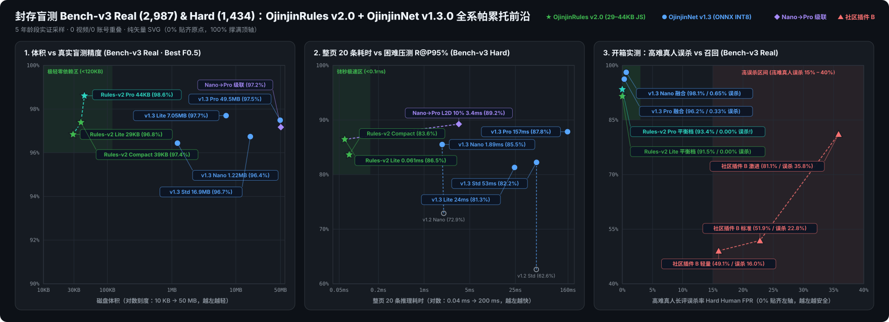
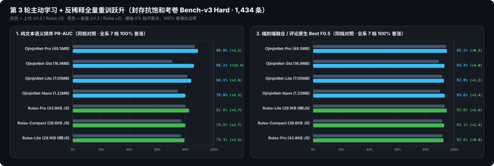
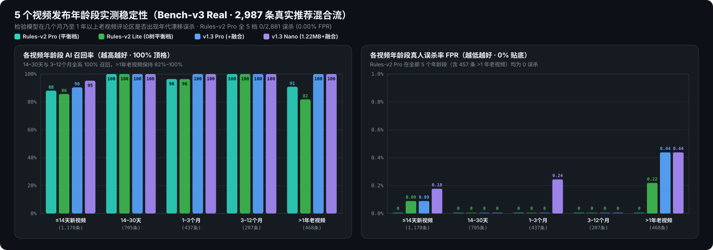
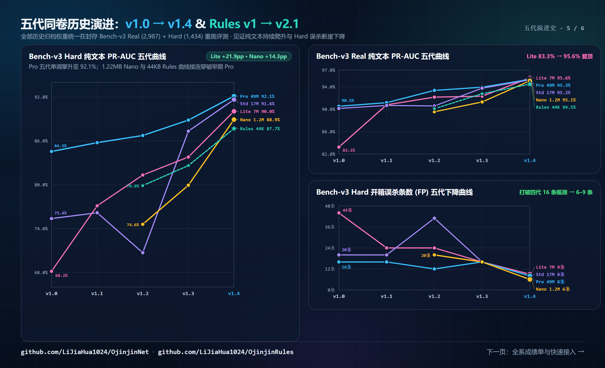
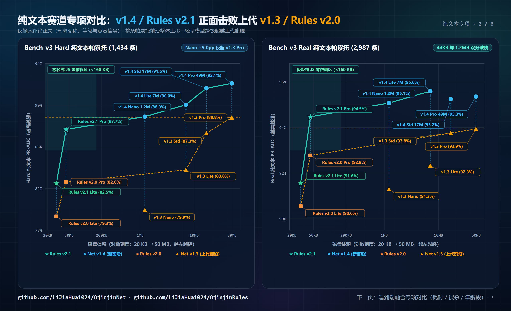
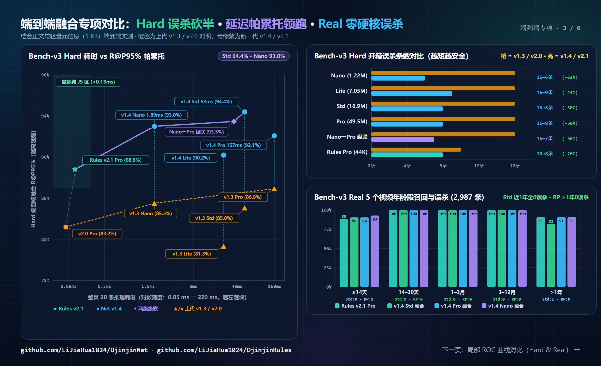
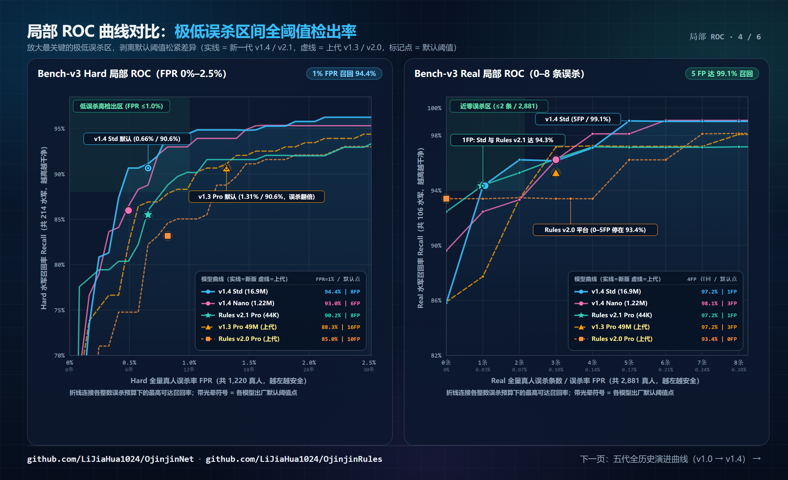

# OjinjinBench-v1 评测规范与横向对比报告

## 1. 评测集构造原则

1. **时间洁净度（Temporal Hygiene）**：评测集与验证集全部取自近期同一时间窗口的真实社区评论，不混入跨年份历史语料，避免模型依赖年代词汇差异。
2. **双维度隔离**：训练集（含主动学习新增轮次）、验证集与评测集按**视频**与**脱敏账号**双重互斥切分，评测集中的视频与发言账号均未在训练、蒸馏、主动学习或校准阶段出现。
3. **纯真实样本**：评测集全部由真实社区评论组成，合成对抗样本仅用于训练阶段增强，不进入评测集。
4. **双视角评估（完整集 1,310 条 + Hard-Only 高难子集 777 条）**：
   - `obvious_ai`（150 条）：命中明显关键词或传统规则高分的显性 AI 评论；
   - `stealth_ai`（160 条）：去掉常见特征词、传统规则得分为零的隐蔽 AI 评论，用于衡量语义泛化能力；
   - `hard_human`（617 条）：高难真人负样本（长篇科普、影评、带时间戳总结、反串玩梗与灰区评论），用于压力测试抗误杀能力；
   - `normal_human`（383 条）：常规真人短评与互动回复。
   - **Hard-Only 高难子集（777 条）**：仅保留 `stealth_ai (160)` 与 `hard_human (617)`，剔除显性 AI 与常规短评，用于在完整集 `PR-AUC` 接近 `0.99` 后仍能清晰区分模型演进幅度。

## 2. 核心指标说明

评论过滤属于静默隐藏/删除场景，误判一条认真撰写的真人长评对体验的影响远大于漏放一条 AI 评论，且真实评论区中正负样本比例不均，因此不以普通准确率（Accuracy）作为主指标。

| 指标 | 方向 | 含义说明 |
|---|:-:|---|
| **PR-AUC** | 越高越好 | 不固定阈值，衡量模型将 AI 评论整体排在真人评论之前的能力，对类别不平衡较敏感且不受单点阈值波动影响。 |
| **Best F0.5** | 越高越好 | 将精确率（少误杀）权重设为召回率 2 倍的综合单点指标，较 `R@P99%` 更稳健，契合静默过滤目标。 |
| **`Recall@P95%`** | 越高越好 | 约束精确率不低于 95%（每拦截 20 条最多允许 1 条误判/争议）时的 AI 召回率，反映常规高强度过滤覆盖率。 |
| **`Recall@P99%`** | 越高越好 | 约束精确率不低于 99%（每拦截 100 条最多允许 1 条误判）时的保守档召回率；该单点受个别边界样本影响较大，宜结合 `PR-AUC` 与 `Best F0.5` 一并评估。 |
| **隐蔽 AI 召回（P95）** | 越高越好 | 在 160 条规则零分隐蔽 AI 子集上的捕获比例，用于检验模型是否掌握生成式语体而非单纯匹配关键词。 |
| **难负真人误杀率（P95）** | 越低越好 | 在 617 条高难真人长评上的误判率，全表唯一越低越好的识别指标。 |

## 3. 赛道划分与帕累托效率图

- **分赛道评测**：纯文本赛道（仅输入评论正文）用于不同模型间的公平横向对照；端到端融合赛道（正文 + 1 KB 轻量元信息）用于对比规则引擎与实际部署表现。
- **质量与硬件分离展示**：交互看板 [`index.html`](index.html) 中的质量综合分按公开公式计算（`30% PR-AUC + 30% Best F0.5 + 25% 隐蔽 AI 召回 + 15% (1 - 难负误杀率)`）；模型体积（MB）与 PC 分桶耗时（ms）独立通过体积-性能帕累托图呈现，不混入质量总分。

## 4. 数据公开政策

出于对社区用户隐私与原始 UGC 版权的尊重，本仓库公开模型推理代码、评测指标脚本与 ONNX INT8 权重，不公开发布原始抓取评论文本。使用者可用自有合规脱敏 JSONL 数据通过 `src/ojinjinnet/benchmark.py` 复现全部评测流程。

---

## 5. 全市场横向竞品评测（23 款公开方案 · 33 组实测）

为系统对比端侧轻量蒸馏模型与现有社区规则工具、通用开源 AI 文本检测模型、浏览器冻结向量检索方案及端侧小大模型的表现差异，我们在同一份冻结的 `OjinjinBench-v1`（`1,310` 条完整集与 `777` 条 `Hard-Only` 高难子集）上完成了统一评测（交互式图表见 [`index.html#arena`](index.html#arena)）。

### 5.1 评测协议与边界披露

1. **8 款 HuggingFace 开源中文/多语言检测模型（390 MB – 1.06 GB）**：全部加载官方原版权重以 FP32 推理。评测前均使用标准 ChatGPT 中文正式论述段落验证官方 `id2label` 类别方向正常（在正式段落上均输出 `0.964 – 1.000`），排除标签极性配置错误。
2. **2 款端侧小大模型（`Qwen/Qwen3-0.6B`、`Qwen/Qwen2.5-0.5B-Instruct`）**：采用零样本指令分类（关闭思考链以匹配短评吞吐约束），直接读取首 token 对数概率并计算连续分数 `sigmoid(logit("是") - logit("否"))`，以统一口径计算 `PR-AUC`、`Best F0.5` 与 `Recall@P95%`。
3. **浏览器冻结向量检索方案（`Xenova/bge-small-zh-v1.5`）**：复现其均值去各向异性归一化（anisotropy mean-centering）与余弦 `k=3` 近邻检索逻辑（使用 50 条真实 AI 样本作为示例库）；另加测“50 正例 + 50 负例质心差值”作为冻结表征架构的上限对照。
4. **12 款社区开源规则插件与脚本（离线模式）**：全部在 Node.js 环境中直接运行未修改的原版评分/匹配源码，输入评测集内已有的评论正文、昵称、用户等级、回复关系、点赞数、楼层回复数、时间戳与视频标题。
   - **离线边界**：评测集未采集用户个人简介（`sign`）与头像图片，且全部在纯本地离线模式下评测，未启用部分插件可选的付费云端大模型复核 API。
   - **匿名化处理**：为保持技术评测客观中立、避免对个人开源作者点名，本文以 `社区规则插件 A–L` 匿名呈现全部 12 款插件的实测原值及档位切换特征。

### 5.2 开源检测模型、冻结向量与端侧小大模型明细（纯文本）

> 全部方案仅输入原始评论正文（无元信息），按完整集 `Best F0.5` 降序排列。

| 排名 | 模型 / 方案 | 体积 | 完整集 Best F0.5 | 完整集 PR-AUC | 完整集 R@P95% | 完整集 R@P99% | Hard 子集 Best F0.5 | Hard 子集 PR-AUC | Hard 子集 R@P95% |
|---:|---|---:|---:|---:|---:|---:|---:|---:|---:|
| 1 | **`OjinjinNet-Pro v1.1` (纯文本 INT8)** | 49.49 MB | **0.9685** | **0.9826** | **93.5%** | **73.6%** | **0.9563** | **0.9682** | **89.4%** |
| 2 | **`OjinjinNet-Standard v1.1` (纯文本 INT8)** | 16.86 MB | 0.9514 | 0.9723 | 88.4% | 43.9% | 0.9322 | 0.9528 | 83.8% |
| 3 | **`OjinjinNet-Lite v1.1` (纯文本 INT8)** | 7.05 MB | 0.9444 | 0.9686 | 86.5% | 36.1% | 0.9284 | 0.9458 | 80.0% |
| 4 | 冻结 `bge-small-zh-v1.5` 向量（50正+50负质心上限） | 24.0 MB | 0.6657 | 0.6790 | 6.1% | 5.8% | 0.6158 | 0.6129 | 8.1% |
| 5 | `AnxForever/chinese-ai-detector-bert` | 390.1 MB | 0.4692 | 0.3815 | 0.0% | 0.0% | 0.4534 | 0.3280 | 0.0% |
| 6 | 冻结 `bge-small-zh-v1.5` 向量（实际 `k=3` 检索） | 24.0 MB | 0.4149 | 0.3335 | 0.0% | 0.0% | 0.3258 | 0.2559 | 0.0% |
| 7 | `yuchuantian/AIGC_detector_zhv3short` | 390.1 MB | 0.3759 | 0.3525 | 0.0% | 0.0% | 0.3443 | 0.2979 | 0.0% |
| 8 | `Qwen/Qwen3-0.6B` (零样本 · 596M · Q4~420M) | ~420 MB | 0.3552 | 0.2987 | 0.0% | 0.0% | 0.3125 | 0.2583 | 0.0% |
| 9 | `mokawa3018/cmj-chinese-aigc-text-detector` | 390.1 MB | 0.3512 | 0.3174 | 0.0% | 0.0% | 0.4073 | 0.3467 | 0.0% |
| 10 | `Qwen/Qwen2.5-0.5B-Instruct` (零样本 · 494M · Q4~380M) | ~380 MB | 0.3341 | 0.2708 | 0.3% | 0.3% | 0.2618 | 0.2086 | 0.6% |
| 11 | `yuchuantian/AIGC_detector_zhv3` | 390.1 MB | 0.3332 | 0.3268 | 0.0% | 0.0% | 0.3092 | 0.2981 | 0.0% |
| 12 | `bibbbu/multilingual-ai-human-detector_xlm-roberta-base` | 1.06 GB | 0.3297 | 0.2359 | 0.0% | 0.0% | 0.3125 | 0.2408 | 0.0% |
| 13 | `yuchuantian/AIGC_detector_zhv2` | 390.1 MB | 0.2936 | 0.1919 | 0.0% | 0.0% | 0.2705 | 0.1832 | 0.0% |
| 14 | `Hello-SimpleAI/chatgpt-detector-roberta-chinese` | 390.1 MB | 0.2902 | 0.1913 | 0.0% | 0.0% | 0.3058 | 0.2416 | 0.0% |
| 15 | `qiubin/AIGC_text_detector_zh` | 475.5 MB | 0.2797 | 0.1756 | 0.0% | 0.0% | 0.2448 | 0.1751 | 0.0% |

### 5.3 12 款社区开源规则插件与脚本明细（离线模式 · 匿名化）

> 连续评分型规则插件同时报告全阈值曲线指标（`Best F0.5 / PR-AUC / R@P95%`）与出厂默认档及疑似/激进档的开箱实测（`精确率 / 总召回 / 隐蔽 AI 召回 / 难负真人误杀率`）；纯二值开关档位直接报告该档实测结果。

| 编号与架构特征 | 完整集 Best F0.5 | 完整集 PR-AUC | 完整集 R@P95% | Hard 子集 R@P95% | 开箱实测（精确率 / 总召回 / 隐蔽 AI / 难负真人误杀） |
|---|---:|---:|---:|---:|---|
| **`OjinjinNet-Pro v1.1` (+1KB 融合)** | **0.9702** | **0.9936** | **97.1%** | **89.4%** | P95 档：精 95.3% · 召 97.1% · 隐蔽 94.4% · 误杀 2.27% (301/15) |
| **`OjinjinNet-Standard v1.1` (+1KB 融合)** | 0.9684 | 0.9913 | 95.8% | 86.3% | P95 档：精 95.2% · 召 95.8% · 隐蔽 91.9% · 误杀 2.27% (297/15) |
| **`OjinjinNet-Lite v1.1` (+1KB 融合)** | 0.9686 | 0.9902 | 94.8% | 85.0% | P95 档：精 95.1% · 召 94.8% · 隐蔽 90.0% · 误杀 2.27% (294/15) |
| 社区规则插件 C（三层加权评分扩展） | 0.8403 | 0.8764 | 29.7% | 0.0% | 默认 `≥60`：精 92.2% · 召 57.1% · 隐蔽 18.8% · 误杀 2.43% (177/15) 疑似 `≥35`：精 77.6% · 召 77.1% · 隐蔽 55.6% · 误杀 11.18% (239/69) |
| 社区规则插件 A（高星多规则评分扩展） | 0.8375 | 0.8772 | 32.6% | 0.0% | 默认 `≥60`：精 91.4% · 召 47.7% · 隐蔽 1.2% · 误杀 2.27% (148/14) 疑似 `≥35`：精 78.3% · 召 75.5% · 隐蔽 52.5% · 误杀 10.53% (234/65) 仅纯文本函数：PR-AUC `0.4624` · `R@P95% 0.0%` · Best F0.5 `0.5308` |
| 社区规则插件 E（话术模式分值折叠） | 0.8321 | 0.8550 | 36.1% | 0.0% | 默认 `≥4.5`：精 99.1% · 召 33.6% · 隐蔽 11.2% · 误杀 0.16% (104/1) |
| 社区规则插件 D（3,100 评论实证调参评分） | 0.8241 | 0.6695 | 52.6% | 2.5% | 默认 `≥70`：精 95.8% · 召 51.9% · 隐蔽 19.4% · 误杀 1.13% (161/7) 宽松档：精 90.5% · 召 58.7% · 隐蔽 29.4% · 误杀 3.08% (182/19) |
| 社区规则插件 K（强证据自述优先脚本） | 0.8236 | 0.6709 | 10.7% | 0.0% | 默认严格自述：精 0.0% · 召 0.0% · 隐蔽 0.0% · 误杀 0.00% (0/0) 宽松自述：精 100.0% · 召 0.7% · 隐蔽 0.0% · 误杀 0.00% (2/0) |
| 社区规则插件 G（四特征联合过滤脚本） | 0.8120 | 0.6620 | 0.0% | 0.0% | 默认档：精 84.7% · 召 69.7% · 隐蔽 53.8% · 误杀 5.35% (216/39) |
| 社区规则插件 F（多来源独立证据规则） | 0.8021 | 0.6168 | 15.5% | 0.0% | 隐藏档：精 98.0% · 召 15.5% · 隐蔽 3.8% · 误杀 0.16% (48/1) 疑似档：精 90.5% · 召 55.2% · 隐蔽 31.2% · 误杀 2.92% (171/18) |
| 社区规则插件 I（多维 + 伪口语规则） | 0.7285 | 0.5620 | 1.0% | 0.0% | 默认 `≥55`：精 75.7% · 召 51.3% · 隐蔽 30.6% · 误杀 7.29% (159/51) 严格档：精 73.9% · 召 52.9% · 隐蔽 33.8% · 误杀 8.43% (164/58) |
| 社区规则插件 H（低等级 `<Lv3` + 关键词直拦） | 0.7046 | 0.6361 | 0.0% | 0.0% | 默认档：精 66.4% · 召 93.5% · 隐蔽 88.1% · 误杀 17.83% (290/147) |
| 社区规则插件 J（`@` 门控多维评分） | 0.6926 | 0.6646 | 1.0% | 1.2% | 默认需 `@` 且 `≥6`：精 81.5% · 召 7.1% · 隐蔽 6.9% · 误杀 0.81% (22/5) 去 `@` 门槛 `≥6`：精 71.9% · 召 60.3% · 隐蔽 56.2% · 误杀 11.83% (187/73) |
| 社区规则插件 L（人设 + 自我声明保守规则） | 0.6546 | 0.4509 | 3.5% | 0.0% | 默认档：精 100.0% · 召 3.5% · 隐蔽 0.0% · 误杀 0.00% (11/0) 扩展档：精 92.2% · 召 30.3% · 隐蔽 6.9% · 误杀 1.30% (94/8) |
| 社区规则插件 B（高星三档正则脚本 · 轻量档） | 0.6489 | 0.4798 | 0.0% | 0.0% | 轻量档：精 68.0% · 召 54.8% · 隐蔽 31.9% · 误杀 10.05% (170/80) |
| 社区规则插件 B（高星三档正则脚本 · 标准档） | 0.4289 | 0.3333 | 0.0% | 0.0% | 标准档（叠加 `@`）：精 40.2% · 召 58.4% · 隐蔽 35.6% · 误杀 32.90% (181/269) |
| 社区规则插件 B（高星三档正则脚本 · 激进档） | 0.4857 | 0.4063 | 0.0% | 0.0% | 激进档（叠加冒号/引号/破折号）：精 44.0% · 召 83.5% · 隐蔽 71.9% · 误杀 39.87% (259/330) |

### 5.4 现象分析

1. **硬编码规则的召回与误杀权衡**：规则引擎主要依赖昵称词、特定口癖、账号等级或标点特征。保守阈值面对去掉关键词的隐蔽 AI 召回率普遍低于 `20%`；当规则扩展到冒号、引号、破折号或低等级账号时，容易与结构完整的科普、影评真人长评重合，使高难真人误杀率升至 `10.5% – 39.9%`。
2. **通用中文 AIGC 检测器的域偏移**：8 款 HuggingFace 模型在 ChatGPT 正式论述长文上打分为 `0.964 – 1.000`，但在社区短评场景中 `Recall@P95%` 均为 `0.0%`。通用检测器更偏向以书面正式度区分 AI 与人类，与“伪口语 AI 评论 vs 认真科普长评”的社区实际分布恰好相反。
3. **冻结向量检索的表征错位**：与 `OjinjinNet-Standard` 使用相同的 `bge-small-zh-v1.5` 底座，冻结向量空间主要按评论讨论的话题聚类，难以区分同一话题下的 AI 评论与真人评论（`k=3` 检索 `PR-AUC 0.3335`）；经过蒸馏与主动学习微调后，表征空间转向文风与结构差异，`PR-AUC` 达到 `0.9723`。
4. **0.5B–0.6B 生成式模型的零样本局限**：未针对评论鉴伪微调的 0.5B–0.6B 生成模型在细粒度文风判别上排序能力接近随机基线（`PR-AUC 0.27 – 0.30`），同时体积与计算开销远高于轻量编码器。

---

## 6. OjinjinBench-v2 时间外盲测与 v1.2.0 / Nano 级联结果

为避免模型围绕单一评测集迭代导致隐性过拟合，`v1.2.0` 另行采集了 **33 个 11 月下旬全新视频**（与所有训练、主动学习、`Bench-v1` 在视频 `bvid` 与账号 `mid_hash` 上零重叠）构建 `OjinjinBench-v2`，剔除 24 条标注灰区（`uncertain`）后定稿为 **1,476 条干净测试集**：

- 纯文本正例 `61` 条（其中隐蔽 AI `49` 条、显性 AI `12` 条，无规则低分隐蔽 AI 占比 `35.1%`，约为 `Bench-v1` 的 7 倍）；
- 综合账号正例 `75` 条（另含 `14` 条养鱼号发出的普通口语短评，用于区分纯文本赛道 `p_text` 与融合赛道 `p_overall`）；
- 负例 `1,401` 条（`232` 条高难真人长评 + `1,169` 条普通真人），约 `4%–5%` 低正例比例更贴近真实评论区。

### 6.1 单模型跨版本对照（干净版 OjinjinBench-v2，1,476 条）

| 模型（导出 INT8 ONNX） | 体积 | 整页 20 条 | 纯文本 Full F0.5 | 纯文本 PR-AUC | 纯文本 R@P95% | Hard 子集 F0.5 | +融合综合 F0.5 (`p_overall`) | +融合 R@P95% |
|---|---:|---:|---:|---:|---:|---:|---:|---:|
| **`OjinjinNet-Pro v1.2`** | 49.49 MB | 161.3 ms | **0.9072** | **0.9006** | **70.5%** | **0.9259** | **0.9668** | **85.3%** |
| **`OjinjinNet-Nano v1.2`** | **1.22 MB** | **2.0 ms** | **0.8889** | 0.8818 | 65.6% | 0.9155 | 0.9259 | 77.3% |
| `OjinjinNet-Pro v1.1` *(历史串行)* | 49.49 MB | 240.6 ms | 0.8861 | 0.8926 | 68.8% | 0.8955 | — | — |
| **`OjinjinNet-Standard v1.2`** | 16.86 MB | 52.4 ms | 0.8612 | 0.8528 | 62.3% | 0.8861 | 0.9164 | 77.3% |
| **`OjinjinNet-Lite v1.2`** (KD) | 7.05 MB | 24.2 ms | 0.8429 | 0.8522 | 37.7% | 0.8955 | 0.9325 | 82.7% |
| `OjinjinNet-Standard v1.1` *(历史串行)* | 16.86 MB | 83.0 ms | 0.8439 | 0.8537 | 39.3% | 0.8734 | — | — |
| `OjinjinNet-Lite v1.1` *(历史串行)* | 7.05 MB | 44.6 ms | 0.8145 | 0.8210 | 37.7% | 0.8612 | — | — |

### 6.2 `Nano (1.22 MB) → Pro v1.2` 两级级联实测（阈值仅在独立验证集标定）

| 策略与预设预算 | `Bench-v2` 实测转交率 | 端到端整页耗时 (`p50 / 均值`) | 相对 Pro 提速 (`p50`) | 纯文本 Full F0.5 | 纯文本 R@P95% | Hard 子集 F0.5 | +融合综合 F0.5 | +融合 R@P95% |
|---|---:|---:|---:|---:|---:|---:|---:|---:|
| Naive 置信度 · 10% 档 | **7.0%** | **22.9 / 26.6 ms** | **7.0×** | 0.8980 | **72.1%** | **0.9326** | 0.9517 | 85.3% |
| L2D-FP 防误杀头 · 10% 档 | **8.4%** | **23.6 / 28.6 ms** | **6.8×** | 0.8921 | 70.5% | 0.9259 | 0.9552 | **86.7%** |
| Naive 置信度 · 15% 档 | **11.5%** | **29.4 / 35.2 ms** | **5.5×** | **0.9072** | 70.5% | 0.9259 | **0.9633** | 85.3% |
| L2D-FP 防误杀头 · 15% 档 | **12.0%** | **31.9 / 36.3 ms** | **5.1×** | 0.8980 | **72.1%** | **0.9326** | 0.9587 | **88.0%** |

> 注：以上 `v1.2` 耗时统一在本地 PC（AMD Ryzen 5 5600X / ONNX Runtime `1.32.0`，`num_threads=4`，开启 `--parallel-buckets`）上复测得到：单模型采用 `ojinjinnet-speedbench`（`12×32 + 5×64 + 3×128` 20 条分桶整页 `p50`，含单遍 WordPiece 分词与 8K 词片缓存；`Nano` 由优化前 `b55589f` 的 `5.30 ms` 降至串行 `3.66 ms`、并行 `2.00 ms`，端到端提速 **`2.66×`**，`Lite / Standard / Pro` 并行相对串行分别提速 `1.63× / 1.50× / 1.31×`）；级联耗时采用 `OjinjinCascadeClassifier.predict_detailed` 对 `Bench-v2` 真实分页（73 页共 1,460 条评论）的端到端实测统计（`Bench-v1` 65 页实测 `p50` 为 `36.7–53.8 ms`）。历史 `v1.1` 行保留优化前串行基线作为对照。

---

## 7. OjinjinBench-v3 封存实景双卷与 v1.3.0 / Rules v2.0 实测

### 7.1 三层防刷榜构造协议与实证分布

为解决早期基准仅覆盖近几天新视频、易在多轮迭代后趋近饱和的问题，`v1.3.0` 构建了与所有训练、主动学习、蒸馏语料严格 `0 bvid / 0 mid_hash` 重叠的封存双卷 **`OjinjinBench-v3`**，全部经双盲标注（402 条 2024 年前历史真评论零误标校准 `0/402 FP`）并剔除灰区（`uncertain`）：

1. **`OjinjinBench-v3 Real`（2,987 条 · 116 个全新视频）**：严格按实证推荐流入口配比（首页推荐 `47.4%`、相关视频 `33.7%`、中性搜索 `18.9%`）抽样，并覆盖全部 5 个视频发布年龄段：`≤14 天`（`1,170` 条）、`14–30 天`（`705` 条）、`1–3 个月`（`437` 条）、`3–12 个月`（`207` 条）、`>1 年` 老视频（`468` 条）。正负样本分布贴近真实评论区：纯文本 AI `92` 条（`3.08%`）、综合账号 AI `106` 条（`3.55%`），含高难真人 `307` 条与普通真人 `2,574` 条（剔除 13 条灰区）。
2. **`OjinjinBench-v3 Hard`（1,434 条 · 127 个全新视频）**：防饱和困难压测卷，重点富集去模板隐蔽 AI（`159` 条）、结构工整的高难真人长评（`394` 条）以及 `>1 年` 老视频高风险边界评论（`455` 条）；纯文本正例 `155` 条（`10.81%`）、综合账号正例 `214` 条（`14.92%`）（剔除 66 条灰区）。
3. **一次性封存开考**：两套考卷在 `AL-R3` 数据整理、Super-Teacher 蒸馏、模型选模及规则阈值标定全流程保持封存，最终仅使用导出 ONNX INT8 与纯 ES5 JS 成品一次性输出聚合指标。

### 7.2 `v1.3.0` ONNX INT8、`Nano → Pro` 级联与 `OjinjinRules v2.0` 全系明细

| 方案 | 体积 | 20 条耗时 | `Real` 纯文 PR / F0.5 / R@P95 | `Real` 综合 PR / F0.5 / R@P95 | `Real` 开箱 精 / 召 / 高难误杀 | `Hard` 纯文 PR / F0.5 | `Hard` 综合 PR / F0.5 / R@P95 |
|---|---:|---:|---|---|---|---|---|
| **`OjinjinNet-Pro v1.3`** | 49.49 MB | 157.4 ms | `0.9382` / `0.9375` / `81.5%` | `0.9940` / `0.9749` / `97.2%` | 97.1% / 96.2% / 0.33% | **`0.8891`** / **`0.8785`** | **`0.9719`** / **`0.9509`** / `87.8%` |
| **`OjinjinNet-Standard v1.3`** | 16.86 MB | 52.8 ms | **`0.9412`** / **`0.9470`** / **`84.8%`** | `0.9925` / `0.9674` / `96.2%` | 96.2% / 95.3% / 0.33% | `0.8607` / `0.8346` | `0.9674` / `0.9333` / `82.2%` |
| **`OjinjinNet-Lite v1.3`** (KD) | 7.05 MB | 24.3 ms | `0.9227` / `0.9239` / `76.1%` | **`0.9961`** / `0.9770` / **`98.1%`** | 98.0% / 94.3% / 0.33% | `0.8412` / `0.8422` | `0.9673` / `0.9294` / `81.3%` |
| **`OjinjinNet-Nano v1.3`** | **1.22 MB** | **1.89 ms** | `0.9130` / `0.9102` / `71.7%` | `0.9901` / `0.9644` / **`98.1%`** | 95.4% / **98.1%** / 0.65% | `0.7993` / `0.8171` | `0.9621` / `0.9356` / `85.5%` |
| **`Nano→Pro v1.3` (L2D 10%)** | 1.2+49.5 MB | **3.4 ms** (均值 `8.8`) | `0.9113` / `0.9191` / `76.1%` | `0.9889` / `0.9601` / `97.2%` | `3.1%` 转交 · 46.3× 提速 | `0.8779` / **`0.8855`** | `0.9704` / `0.9447` / **`89.2%`** |
| **`Nano→Pro v1.3` (Naive 15%)** | 1.2+49.5 MB | **10.7 ms** (均值 `12.5`) | `0.9268` / `0.9375` / `82.6%` | `0.9916` / `0.9717` / `97.2%` | `5.5%` 转交 · 14.7× 提速 | `0.8738` / `0.8688` | `0.9685` / `0.9434` / `86.0%` |
| **`OjinjinRules v2.0 Pro`** | **43.8 KB JS** | **0.072 ms** | `0.9278` / `0.9245` / `77.2%` | `0.9915` / **`0.9861`** / `96.2%` | **100.0% / 93.4% / 0.00%** (`0 FP`) | `0.8262` / `0.8522` | `0.9604` / `0.9263` / `83.2%` |
| **`OjinjinRules v2.0 Lite`** (0 树) | **29.1 KB JS** | **0.061 ms** (`isAi` `0.048`) | `0.9056` / `0.9270` / `71.7%` | `0.9875` / `0.9684` / `94.3%` | **98.0% / 91.5% / 0.00%** (`2 FP`) | `0.7934` / `0.8182` | `0.9679` / `0.9497` / `86.5%` |
| **`OjinjinRules v2.0 Compact`** | **38.6 KB JS** | **0.071 ms** | `0.9074` / `0.9157` / `71.7%` | `0.9829` / `0.9739` / `95.3%` | **99.0% / 88.7% / 0.00%** (`1 FP`) | `0.7994` / `0.8406` | `0.9592` / `0.9313` / `83.6%` |
| *对比：`OjinjinNet-Pro v1.2`* | *49.49 MB* | *161.3 ms* | *0.9337 / 0.9342 / 78.3%* | *0.9930 / 0.9761 / 98.1%* | *96.3% / 98.1% / 0.33%* | *0.8673 / 0.8571* | *0.9683 / 0.9455 / 89.7%* |
| *对比：`OjinjinNet-Std v1.2`* | *16.86 MB* | *52.4 ms* | *0.9059 / 0.8764 / 66.3%* | *0.9897 / 0.9684 / 97.2%* | *94.5% / 97.2% / 0.33%* | *0.7070 / 0.7121* | *0.9373 / 0.8932 / 62.6%* |
| *对比：`OjinjinNet-Lite v1.2`* | *7.05 MB* | *24.2 ms* | *0.9216 / 0.9176 / 75.0%* | *0.9942 / 0.9758 / 99.1%* | *97.2% / 99.1% / 0.65%* | *0.8132 / 0.7828* | *0.9589 / 0.9169 / 77.1%* |
| *对比：`OjinjinNet-Nano v1.2`* | *1.22 MB* | *2.00 ms* | *0.8955 / 0.8750 / 62.0%* | *0.9893 / 0.9717 / 97.2%* | *93.6% / 97.2% / 0.65%* | *0.7459 / 0.7715* | *0.9438 / 0.9018 / 72.9%* |
| *对比：社区规则插件 B（轻 / 标 / 激进）* | *人工正则* | *<0.2 ms* | *—* | *—* | *49.1% / 49.1% / 16.0%* *14.3% / 51.9% / 22.8%* *16.5% / 81.1% / 35.8%* | *—* | *高难误杀 17.0% / 19.0% / 37.8%* |

### 7.3 5 个视频发布年龄段实测（`Bench-v3 Real` · 防老视频年代漂移）

| 视频年龄段 (`n` / `AI`) | `Rules-v2 Pro` (平衡) Recall / FPR (`FP`) | `Rules-v2 Lite` (平衡) Recall / FPR (`FP`) | `v1.3 Pro` (+融合) Recall / FPR (`FP`) | `v1.3 Lite` (+融合) Recall / FPR (`FP`) | `v1.3 Nano` (+融合) Recall / FPR (`FP`) |
|---|---|---|---|---|---|
| `≤14 天` (`1,170` / `42`) | 88.1% / **0.00%** (`0`) | 85.7% / 0.09% (`1`) | 90.5% / 0.09% (`1`) | 92.9% / **0.00%** (`0`) | 95.2% / 0.18% (`2`) |
| `14–30 天` (`705` / `20`) | **100.0%** / **0.00%** (`0`) | **100.0%** / **0.00%** (`0`) | **100.0%** / **0.00%** (`0`) | 95.0% / **0.00%** (`0`) | **100.0%** / **0.00%** (`0`) |
| `1–3 个月` (`437` / `28`) | 96.4% / **0.00%** (`0`) | 96.4% / **0.00%** (`0`) | **100.0%** / **0.00%** (`0`) | **100.0%** / **0.00%** (`0`) | **100.0%** / 0.24% (`1`) |
| `3–12 个月` (`207` / `5`) | **100.0%** / **0.00%** (`0`) | **100.0%** / **0.00%** (`0`) | **100.0%** / **0.00%** (`0`) | **100.0%** / **0.00%** (`0`) | **100.0%** / **0.00%** (`0`) |
| `>1 年` (`468` / `11`) | **90.9%** / **0.00%** (`0/457`) | 81.8% / 0.22% (`1/457`) | **100.0%** / 0.44% (`2/457`) | 81.8% / 0.44% (`2/457`) | **100.0%** / 0.44% (`2/457`) |

---

## 8. `v1.4.0` 与 `OjinjinRules v2.1.0` 封存双卷实测与五代演进

`v1.4.0` 与配套 `OjinjinRules v2.1.0` 在保持相同封存协议（零接触 `Bench-v3 Real (2,987)` 与 `Bench-v3 Hard (1,434)`）的前提下完成全系重训、蒸馏与一次性开考。

### 8.1 `v1.4.0` ONNX INT8、`Nano → Pro` 级联与 `OjinjinRules v2.1.0` 封存明细

| 方案 | 体积 | 20 条耗时 | `Real` 纯文 PR / F0.5 / R@P95 | `Real` 综合 PR / F0.5 / R@P95 | `Real` 开箱默认 精 / 召 / 误杀 | `Hard` 纯文 PR / F0.5 | `Hard` 综合 PR / F0.5 / R@P95 / 误杀 |
|---|---:|---:|---|---|---|---|---|
| **`OjinjinNet-Pro v1.4`** | 49.49 MB | 157.4 ms | `0.9535` / `0.9536` / `85.9%` | `0.9944` / **`0.9825`** / `97.2%` | 98.1% / 95.3% / 2 FP (0 HH) | **`0.9211`** / **`0.9155`** | `0.9802` / `0.9515` / `92.1%` / 8 FP |
| **`OjinjinNet-Standard v1.4`** | 16.86 MB | 52.8 ms | `0.9524` / **`0.9596`** / `90.2%` | `0.9950` / `0.9804` / **`99.1%`** | **99.0%** / 94.3% / **1 FP (0 HH)** | `0.9164` / `0.9105` | `0.9802` / **`0.9566`** / **`94.4%`** / 8 FP |
| **`OjinjinNet-Lite v1.4`** (KD) | 7.05 MB | 24.3 ms | **`0.9559`** / `0.9505` / **`91.3%`** | **`0.9960`** / `0.9796` / **`99.1%`** | 98.0% / 93.4% / 2 FP (1 HH) | `0.9004` / `0.8909` | `0.9771` / `0.9452` / `90.2%` / 9 FP |
| **`OjinjinNet-Nano v1.4`** | **1.22 MB** | **1.89 ms** | `0.9507` / `0.9407` / `85.9%` | `0.9956` / `0.9774` / `98.1%` | 97.1% / **96.2%** / 3 FP (1 HH) | `0.8890` / `0.8838` | `0.9783` / `0.9489` / `93.0%` / **6 FP** |
| **`Nano→Pro v1.4` (L2D 10%)** | 1.2+49.5 MB | ~8.1 ms | `0.9506` / `0.9587` / — | `0.9940` / `0.9783` / `97.2%` | 98.0% / 94.3% / 2 FP (`3.95%` 转交) | **`0.9217`** / **`0.9155`** | **`0.9810`** / `0.9540` / `93.5%` / 7 FP |
| **`OjinjinRules v2.1 Pro`** | **44.1 KB JS** | **0.101 ms** | `0.9447` / `0.9311` / `79.4%` | `0.9936` / `0.9839` / `97.2%` | 99.0% / 94.3% / 1 FP (0 HH) 严格档 100% / 90.6% / 0 FP | `0.8768` / `0.8881` | `0.9665` / `0.9410` / `88.8%` / 8 FP (3 HH) |
| **`OjinjinRules v2.1 Compact`** | **38.9 KB JS** | **0.090 ms** | `0.9101` / `0.8951` / `67.4%` | `0.9873` / `0.9749` / `97.2%` | 97.1% / 95.3% / 3 FP (1 HH) | `0.8243` / `0.8656` | `0.9599` / `0.9343` / `85.5%` / 8 FP (3 HH) |
| **`OjinjinRules v2.1 Lite`** (0 树) | **29.1 KB JS** | **0.086 ms** | `0.9157` / `0.8995` / `71.7%` | `0.9882` / `0.9661` / `94.3%` | 96.2% / 94.3% / 4 FP (2 HH) | `0.8250` / `0.8534` | `0.9677` / `0.9459` / `86.9%` / **6 FP (2 HH)** |

### 8.2 五代同卷演进明细（`v1.0 → v1.4` 历史归档统一重跑 `Bench-v3`）

| 规格 | 版本 | `Real` 纯文 PR | `Hard` 纯文 PR | `Hard` 综合 PR | `Hard` 开箱误杀 (FP) |
|---|---|---:|---:|---:|---:|
| **Pro (49.5 MB)** | `v1.0 → v1.1 → v1.2 → v1.3 → v1.4` | `0.9054 → 0.9118 → 0.9337 → 0.9394 → 0.9535` | `0.8455 → 0.8575 → 0.8673 → 0.8883 → 0.9211` | `0.9638 → 0.9654 → 0.9683 → 0.9710 → 0.9802` | `16 → 16 → 12 → 16 → 8` |
| **Standard (16.9 MB)** | `v1.0 → v1.1 → v1.2 → v1.3 → v1.4` | `0.9014 → 0.9068 → 0.9059 → 0.9376 → 0.9524` | `0.7537 → 0.7617 → 0.7070 → 0.8732 → 0.9164` | `0.9436 → 0.9513 → 0.9373 → 0.9698 → 0.9802` | `20 → 20 → 41 → 16 → 8` |
| **Lite (7.05 MB)** | `v1.0 → v1.1 → v1.2 → v1.3 → v1.4` | `0.8325 → 0.9079 → 0.9216 → 0.9233 → 0.9559` | `0.6816 → 0.7711 → 0.8132 → 0.8379 → 0.9004` | `0.9184 → 0.9582 → 0.9589 → 0.9665 → 0.9771` | `44 → 24 → 24 → 16 → 9` |
| **Nano (1.22 MB)** | `v1.2 → v1.3 → v1.4` | `0.8955 → 0.9130 → 0.9507` | `0.7459 → 0.7993 → 0.8890` | `0.9438 → 0.9621 → 0.9783` | `20 → 16 → 6` |
| **Rules Pro (44 KB)** | `v1 → v2.0 → v2.1` | `0.9009 → 0.9278 → 0.9447` | `0.7988 → 0.8262 → 0.8768` | `0.9557 → 0.9604 → 0.9665` | `4 → 10 → 8` |

### 8.3 `v1.4.0` 与 `Rules v2.1` 在 5 个视频发布年龄段实测（`Bench-v3 Real`）

| 视频年龄段 (`n` / `AI`) | `Rules v2.1 Pro` (平衡) Recall / FPR (`FP`) | `v1.4 Std` (+融合) Recall / FPR (`FP`) | `v1.4 Pro` (+融合) Recall / FPR (`FP`) | `v1.4 Nano` (+融合) Recall / FPR (`FP`) |
|---|---|---|---|---|
| `≤14 天` (`1,170` / `42`) | 88.1% / 0.09% (`1`) | **90.5%** / **0.00%** (`0`) | 90.5% / 0.09% (`1`) | 92.9% / 0.09% (`1`) |
| `14–30 天` (`705` / `20`) | **100.0%** / **0.00%** (`0`) | **100.0%** / **0.00%** (`0`) | **100.0%** / **0.00%** (`0`) | **100.0%** / **0.00%** (`0`) |
| `1–3 个月` (`437` / `28`) | **100.0%** / **0.00%** (`0`) | **100.0%** / **0.00%** (`0`) | **100.0%** / **0.00%** (`0`) | **100.0%** / **0.00%** (`0`) |
| `3–12 个月` (`207` / `5`) | **100.0%** / **0.00%** (`0`) | **100.0%** / **0.00%** (`0`) | **100.0%** / **0.00%** (`0`) | **100.0%** / **0.00%** (`0`) |
| `>1 年` (`468` / `11`) | **90.9%** / **0.00%** (`0/457`) | 81.8% / 0.22% (`1/457`) | 90.9% / 0.22% (`1/457`) | 90.9% / 0.44% (`2/457`) |
